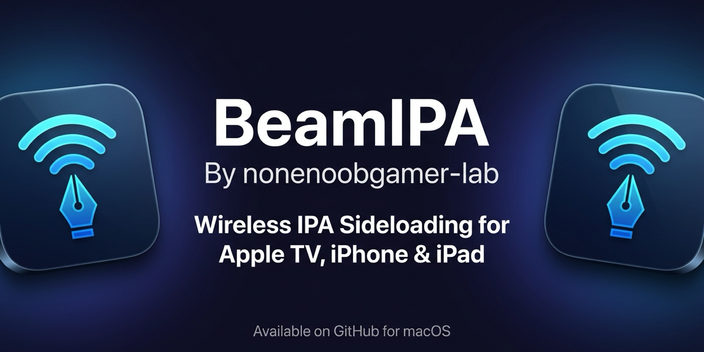

  

# BeamIPA

**BeamIPA** is a native macOS utility for wirelessly signing, installing, and refreshing `.ipa` apps on **Apple TV (tvOS)**, **iPhone (iOS)**, and **iPad (iPadOS)**—built to make 7-day Personal Team sideloading simple, reliable, and automated.

---

## Why BeamIPA?

- **Built for Apple TV (tvOS) + iOS/iPadOS:** Most sideloaders treat Apple TV as an afterthought. BeamIPA supports wireless LAN/CoreDevice discovery and **Pair by IP** with on-screen Apple TV PIN pairing out of the box.
- **Two Signing Backends in One App:** Use standalone **Apple ID + Anisette v3** (with an embedded Anisette server and public server fallback, no Xcode required) *or* **Xcode Automatic Provisioning** with your macOS Keychain certificate.
- **Proactive Personal Team Guardrails:** Tracks Apple's 3-app active device cap and 10 App IDs per 7-day window before an install fails, with tiered expiration reminders (`48h`, `36h`, `12h`, `0h`).
- **Links Apps Sideloaded Elsewhere:** Detects apps already sideloaded onto your device and lets you link their `.ipa` for one-click refreshes.
- **100% Native macOS Experience:** Built with SwiftUI and SwiftData—featuring drag-and-drop `.ipa` import, automatic `PlugIns`/`Watch` extension stripping, a live sideloading progress bar, and a menu bar companion.
- **Install & Update Directly from GitHub:** Paste any GitHub repo or `.git` URL to fetch `.ipa` releases, match against cached apps, link repos, and get automatic out-of-date notifications with one-click version updates.
- **In-App Help & Setup Guide:** Built-in Help window covering Apple TV/iOS pairing, signing modes, 7-day limits, and troubleshooting.

---

## Version Notes

### v1.1
- **Install & Update from GitHub:** Paste any GitHub repository URL, `.git` clone URL, or `.ipa` link to fetch, sign, and beam `.ipa` releases directly to your Apple TV, iPhone, or iPad.
- **Cached App Matching & Repo Linking:** Automatically matches GitHub repository names against your cached apps, shows your currently installed version, and lets you link the repository for one-click **Update IPA** version selection.
- **Automatic Out-of-Date Detection:** Checks linked GitHub repositories automatically and highlights out-of-date `.ipa` apps with an **Out of date** badge.
- **In-App Help & Setup Guide:** Added a dedicated **Help** button in the toolbar with step-by-step setup, signing mode comparisons, 7-day limit info, and troubleshooting.
- **UI & Update Improvements:** Added a bottom sideloading progress bar, menu bar app icon, cleaner Settings **Method** layout, and `BeamIPA` rebrand.

### v1.0
- Initial public release of BeamIPA for Apple Silicon macOS with wireless/USB discovery, Apple ID + Anisette v3 and Xcode Automatic Provisioning support, Personal Team guardrails, and menu bar companion.

---

## Key Features

- **Wireless & USB Device Discovery**
  - Automatically scans your local network and USB connections for paired **Apple TV**, **iPhone**, and **iPad** devices.
  - Supports **Pair by IP** with on-screen PIN pairing for Apple TVs and networked devices.
- **Drag-and-Drop `.ipa` Sideloading**
  - Drop any `.ipa` file directly into BeamIPA or use **Import .ipa** from the toolbar.
  - Automatically strips incompatible app extensions (`PlugIns` and `Watch` companions) and rewrites bundle identifiers so free Personal Team signing succeeds cleanly.
- **Two Signing & Provisioning Modes**
  - **Apple ID + Anisette (No Xcode Required):** Sign in with your Apple ID (supporting 2FA) and use an Anisette v3 server (or pick from the built-in server directory) to generate signing certificates and provisioning profiles.
  - **Xcode Automatic Provisioning:** Use an Apple account already signed into Xcode (`Xcode → Settings → Accounts`) to register your device and generate `.mobileprovision` files automatically, then sign with your macOS Keychain development certificate.
- **Personal Team Guardrails & Expiration Tracking**
  - Tracks the 7-day signing expiration window with tiered countdown alerts (`48h`, `36h`, `12h`, `0h`).
  - Enforces Apple's free Personal Team limits (3 active sideloaded apps per device and 10 App IDs per rolling 7-day window) before you hit cryptic installation errors.
- **Previously Sideloaded App Reconciliation**
  - Detects apps already sideloaded onto your device (even if originally installed via Xcode or another tool) and lets you link the `.ipa` for one-click re-signing and refresh.
- **Menu Bar Companion & In-App Updates**
  - Monitor upcoming app expirations, trigger device scans, and check for new BeamIPA releases directly from the menu bar or main window.

---

## Requirements

- **Mac:** Apple Silicon (`arm64`) Mac (current release built with `LSMinimumSystemVersion` `27.2`).
- **Target Device:** **Apple TV (tvOS)**, **iPhone (iOS)**, or **iPad (iPadOS)** on the same local Wi-Fi network (or connected via USB for initial pairing).
  - On **iOS / iPadOS 16+**, **Developer Mode** must be enabled (**Settings → Privacy & Security → Developer Mode**).
- **Apple Account:** A free Apple ID (Personal Team) or paid Apple Developer account.
  - *Free Apple ID limits:* Apple enforces a **3 active sideloaded apps per device** cap, **10 App IDs per rolling 7-day window**, and a **7-day signature expiration** (which BeamIPA tracks and helps you refresh).
- **Provisioning Backend (choose one):**
  - **Apple ID + Anisette (No Xcode required):** Access to an Anisette v3 server (via the built-in server list or a self-hosted Anisette v3 instance).
  - **Xcode Automatic Provisioning (Optional):** Xcode installed and signed into an Apple Account (**Xcode → Settings → Accounts**), with your target device registered to your team at least once.

---

## Installation

1. Download **`BeamIPA-1.1.dmg`** from this repository or the [Releases](../../releases) page.
2. Open the `.dmg` and drag **BeamIPA.app** into your **Applications** folder.
3. Launch **BeamIPA** from Applications.
   - *Note:* If macOS Gatekeeper warns that the app is from an unidentified developer, right-click (Control-click) **BeamIPA.app** → **Open** → **Open**, or allow it in **System Settings → Privacy & Security**.

---

## How to Use BeamIPA

### 1. Pair Your Device
- **Apple TV (Wi-Fi):**
  1. Ensure your Mac and Apple TV are on the same Wi-Fi/local network.
  2. On Apple TV, go to **Settings → Remotes and Devices → Remote App and Devices** (or ensure it is discoverable).
  3. Click **Scan** in BeamIPA's toolbar (or **Pair by IP** if you want to enter the Apple TV's IP address directly).
  4. Enter the 4-digit PIN displayed on your TV screen when prompted.
- **iPhone / iPad:**
  - Connect via USB once and tap **Trust** on the device (or pair over Wi-Fi if already trusted with your Mac), then click **Scan**.

### 2. Configure Signing Setup
Click **Sign In** or **Signing Setup** (or open **Settings → Provisioning**):

- **Option A — Apple ID + Anisette (Recommended for standalone use):**
  1. Click **Sign In** and enter your Apple ID & password (complete 2FA if prompted).
  2. In **Settings → Anisette**, keep the default Anisette server or choose/enter a custom Anisette v3 server URL and click **Test**.
  3. In **Settings → Provisioning**, set **Auto-Provisioning & Refresh Method** to **Apple ID + Anisette**.

- **Option B — Xcode Automatic Provisioning:**
  1. Open **Xcode → Settings → Accounts** and sign in with your Apple ID.
  2. Make sure your Apple TV or iOS device has been connected/registered to your team at least once.
  3. In BeamIPA **Settings → Provisioning**, select **Xcode** as the Auto-Provisioning & Refresh Method and choose your macOS Keychain development certificate.

### 3. Sideload an `.ipa`
1. Select your paired device in the left sidebar.
2. Drag and drop an `.ipa` file onto the BeamIPA window, or click **Import .ipa** in the toolbar.
3. Click **Sign & Install**. BeamIPA will patch the bundle, provision/sign the app, and install it wirelessly (or over USB) onto your device.

### 4. Refresh Apps Before They Expire
- Free Apple ID (Personal Team) signatures expire after **7 days**.
- BeamIPA displays each app's remaining time in the main list and the menu bar popover.
- Click **Refresh** on any tracked app before it expires to re-sign and reinstall it in place without losing app data.
- If an app was already installed before you started using BeamIPA, click **Link .ipa** next to the discovered app to attach its `.ipa` for future refreshes.

---

## How BeamIPA Works Under the Hood

BeamIPA combines native Apple tooling with open-source device and signing libraries into a single macOS pipeline:

1. **Device Discovery & Pairing (`usbmuxd` + CoreDevice)**
   - Scans for connected and network-paired devices using Apple's `devicectl` / CoreDevice services and `usbmuxd` pairing records, storing pairing metadata locally in Application Support.
2. **IPA Inspection & Patching**
   - Unpacks the `.ipa` archive, inspects `Info.plist`, strips nested `PlugIns/` and `Watch/` extensions that cannot be signed under a free Personal Team, and rewrites `CFBundleIdentifier` to a unique team-scoped identifier when required.
3. **Provisioning & Certificate Management**
   - **Apple ID + Anisette mode:** Authenticates with Apple's GrandSlam (SRP-6a) protocol using Anisette v3 headers, generates a 2048-bit RSA CSR + `.p12` signing identity, registers App IDs/devices, and downloads the `.mobileprovision` profile.
   - **Xcode mode:** Invokes `xcodebuild -allowProvisioningUpdates` against a minimal stub project for the target platform (`tvOS` / `iOS`) and device UDID to obtain a valid `.mobileprovision`, then signs using your Keychain certificate.
4. **Code Signing & Deployment (`zsign` + `idevice`)**
   - Embeds the provisioning profile and signs the Mach-O binary and resources with `zsign` (or macOS `codesign`), then streams and installs the signed bundle to your Apple TV, iPhone, or iPad over Wi-Fi or USB.
5. **Local Guardrails & State**
   - Tracks installed apps, expiration timestamps, active app slots (3-app cap), and App ID registrations (10 per 7 days) locally in SwiftData.

---

## Troubleshooting

- **"Your team has no devices from which to generate a provisioning profile" (Xcode mode):**
  - Connect your device to Xcode once (or register its UDID in Apple Developer / Xcode **Window → Devices and Simulators**), or switch to **Apple ID + Anisette** mode in **Settings → Provisioning**.
- **Reached 3-App Limit:**
  - Free Apple IDs allow up to 3 active sideloaded apps per device. Remove an unused sideloaded app on the device or refresh an existing app instead of installing a 4th.
- **Device Not Showing Up:**
  - Confirm your Mac and Apple TV are on the same subnet (no client isolation / guest Wi-Fi), or use **Pair by IP** with the device's local IP address.

---

## Bug Reports & Feature Suggestions

Have you run into a problem or have an idea to improve BeamIPA?

- **Ask Questions & Share Ideas:** Join the conversation in [GitHub Discussions](https://github.com/nonenoobgamer-lab/BeamIPA/discussions).
- **Report a Bug or Request a Feature:** Open an issue on the [GitHub Issues](https://github.com/nonenoobgamer-lab/BeamIPA/issues) page.
- **When reporting a problem, please include:**
  1. Your **Mac model & macOS version**
  2. Your **target device & OS version** (e.g. Apple TV 4K on tvOS 18, iPhone on iOS 18)
  3. Which **signing method** you were using (**Apple ID + Anisette** or **Xcode Automatic Provisioning**)
  4. **Steps to reproduce** and the exact **error message** shown in BeamIPA

---

## Support BeamIPA

If you find BeamIPA useful and want to support ongoing development:

- ☕ **[Buy Me a Coffee](https://buymeacoffee.com/nonenoobgamerlab)** (`https://buymeacoffee.com/nonenoobgamerlab`)
